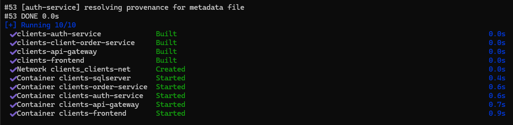
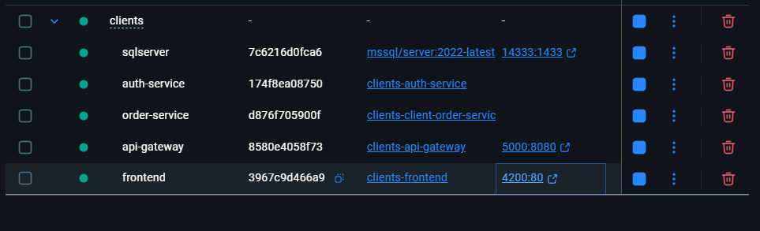

# Plataforma de Gestión de Clientes, Órdenes y Servicios Logísticos

---

## 1. Resumen Ejecutivo

La **Plataforma de Gestión de Clientes y Órdenes** es una solución empresarial diseñada para digitalizar, centralizar y optimizar la administración de clientes corporativos, emisión de trámites, gestión de órdenes de servicio y control de modalidades de transporte logístico (local e internacional).

El sistema está construido bajo los principios de una arquitectura moderna orientada a **Microservicios**, garantizando alta cohesión, bajo acoplamiento, escalabilidad horizontal y despliegue modular mediante contenedores orquestados con **Docker & Docker Compose**.

---

## 2. Índice de Contenidos

1. [Resumen Ejecutivo](#1-resumen-ejecutivo)
2. [Arquitectura del Sistema y Topología de Red](#3-arquitectura-del-sistema-y-topología-de-red)
3. [Matriz de Componentes y Microservicios](#4-matriz-de-componentes-y-microservicios)
4. [Catálogo de Endpoints y Ruteo del API Gateway](#5-catálogo-de-endpoints-y-ruteo-del-api-gateway)
5. [Requisitos Previos del Sistema](#6-requisitos-previos-del-sistema)
6. [Guía de Despliegue con Docker](#7-guía-de-despliegue-con-docker)
7. [Credenciales de Acceso y Datos de Inicialización](#8-credenciales-de-acceso-y-datos-de-inicialización)
8. [Comandos de Operación y Monitoreo](#9-comandos-de-operación-y-monitoreo)
9. [Verificación Visual en Docker Desktop](#10-verificación-visual-en-docker-desktop)

---

## 3. Arquitectura del Sistema y Topología de Red

El ecosistema se implementa en contenedores aislados comunicados a través de una red virtual privada de Docker en modo bridge (clients-net). La seguridad perimetral se garantiza exponiendo únicamente el **Frontend SPA** (servido por Nginx) y el **API Gateway** como único punto de entrada unificado para el consumo de servicios web.

`mermaid
flowchart TD
    subgraph Host[Host / Cliente]
        User([Usuario / Navegador])
        AdminPostman([Cliente API / Postman])
    end

    subgraph DockerNetwork[Red Interna Docker: clients-net]
        Frontend[Frontend Web
Angular 21 + Nginx
Puerto Host: 4200]
        Gateway[API Gateway
Ocelot / .NET 9
Puerto Host: 5000]

        AuthService[AuthService.API
.NET 9 + BCrypt + JWT
Puerto Interno: 8080]
        OrderService[ClientOrderService.API
.NET 9 + EF Core
Puerto Interno: 8080]
        SqlServer[(SQL Server 2022
Linux Container
Puerto Host: 14333
Puerto Interno: 1433)]
    end

    User -->|HTTP :4200| Frontend
    Frontend -->|HTTP :5000| Gateway
    AdminPostman -->|HTTP :5000| Gateway

    Gateway -->|Ruta /api/auth/*| AuthService
    Gateway -->|Ruta /api/clients/*| OrderService
    Gateway -->|Ruta /api/orders/*| OrderService
    Gateway -->|Ruta /api/dashboard/*| OrderService

    AuthService -->|Persistencia ClientsAuthDb| SqlServer
    OrderService -->|Persistencia ClientOrdersDb| SqlServer
`

### Características de la Topología:
* **Perímetro Seguro:** Los microservicios de backend (uth-service y client-order-service) no exponen puertos directamente al host, previniendo accesos directos no autorizados.
* **API Gateway Centralizado:** Unifica políticas de CORS, enrutamiento semántico, control de encabezados y balanceo de carga.
* **Aislamiento de Persistencia:** Bases de datos separadas lógicamente (ClientsAuthDb y ClientOrdersDb) en un motor relacional de alta disponibilidad.

---

## 4. Matriz de Componentes y Microservicios

| Componente | Rol / Responsabilidad | Stack Tecnológico | Puerto Interno | Puerto Host | Dependencias |
| :--- | :--- | :--- | :---: | :---: | :--- |
| **clients-frontend** | Interfaz gráfica de usuario reactiva, diseño modular, autenticación por Guards e interceptor HTTP. | Angular 21, TypeScript, Tailwind CSS, Nginx Alpine | 80 | 4200 | clients-api-gateway |
| **clients-api-gateway** | Puerta de enlace unificada, resolución de rutas y proxy inverso hacia los microservicios. | .NET 9, Ocelot 25.0, YARP Reverse Proxy | 8080 | 5000 | clients-auth-service, clients-order-service |
| **clients-auth-service** | Gestión de identidades, registro seguro, hash de contraseñas con BCrypt y emisión de tokens JWT. | .NET 9, ASP.NET Core, EF Core 9, BCrypt.Net | 8080 | *Privado* | clients-sqlserver |
| **clients-order-service** | Dominio de clientes corporativos, catálogo de órdenes de despacho, modalidad de transporte y KPIs. | .NET 9, ASP.NET Core, EF Core 9 | 8080 | *Privado* | clients-sqlserver |
| **clients-sqlserver** | Motor de base de datos relacional para el almacenamiento transaccional y persistencia de volumen. | Microsoft SQL Server 2022 (Linux Container) | 1433 | 14333 | *Ninguna* |

---

## 5. Catálogo de Endpoints y Ruteo del API Gateway

Todas las peticiones del cliente se procesan a través de la URL base del Gateway: **http://localhost:5000**.

### 5.1. Módulo de Autenticación (AuthService.API)

| Método | Ruta en Gateway | Descripción | Seguridad |
| :--- | :--- | :--- | :--- |
| POST | /api/auth/register | Registro de nuevos usuarios administradores u operadores. | Público |
| POST | /api/auth/login | Autenticación de credenciales y generación del Bearer Token JWT. | Público |
| GET | /api/auth/me | Obtención de la información del perfil del usuario autenticado. | Requiere JWT |

### 5.2. Módulo de Clientes (ClientOrderService.API)

| Método | Ruta en Gateway | Descripción | Seguridad |
| :--- | :--- | :--- | :--- |
| GET | /api/clients | Listado general de clientes con soporte para búsqueda y filtrado por estado (ctive, inactive). | Requiere JWT |
| GET | /api/clients/{id} | Consulta detallada de un cliente por su identificador único (GUID). | Requiere JWT |
| POST | /api/clients | Alta de cliente corporativo (validación de unicidad de RUC/Identificación). | Requiere JWT |
| PUT | /api/clients/{id} | Actualización de datos de contacto, dirección y estado del cliente. | Requiere JWT |
| DELETE | /api/clients/{id} | Eliminación de cliente (bloqueada si posee pedidos o historial asociado). | Requiere JWT |

### 5.3. Módulo de Órdenes y Servicios (ClientOrderService.API)

| Método | Ruta en Gateway | Descripción | Seguridad |
| :--- | :--- | :--- | :--- |
| GET | /api/orders | Consulta de órdenes con filtros combinados (término, estado, cliente, rango de fechas). | Requiere JWT |
| GET | /api/orders/{id} | Detalle completo de orden, desglose de ítems y bandera de transporte logístico. | Requiere JWT |
| POST | /api/orders | Creación de orden de despacho con ítems dinámicos y modalidad de transporte (CheckTransporte). | Requiere JWT |
| PUT | /api/orders/{id} | Modificación integral de orden, notas de despacho y actualización de ítems. | Requiere JWT |
| PATCH | /api/orders/{id}/status | Transición ágil de estado del pedido (Pending, Completed, Cancelled). | Requiere JWT |
| DELETE | /api/orders/{id} | Eliminación lógica/física de orden del sistema. | Requiere JWT |

### 5.4. Módulo de Analítica y Dashboard (ClientOrderService.API)

| Método | Ruta en Gateway | Descripción | Seguridad |
| :--- | :--- | :--- | :--- |
| GET | /api/dashboard/stats | Métricas en tiempo real: total de pedidos, tasa de cumplimiento, volumen facturado y actividad mensual. | Requiere JWT |

---

## 6. Requisitos Previos del Sistema

Para el correcto aprovisionamiento del entorno se requiere:

* **Sistema Operativo:** Windows 10/11 con WSL 2 habilitado, o distribución Linux / macOS compatible.
* **Virtualización:** [Docker Desktop](https://www.docker.com/products/docker-desktop/) (v24.0 o superior) debidamente instalado y en ejecución.
* **Puertos del Host Disponibles:**
  * 4200 (Interfaz de usuario)
  * 5000 (API Gateway)
  * 14333 (Acceso administrativo a SQL Server)

---

## 7. Guía de Despliegue con Docker

### Paso 1: Clonar el repositorio y posicionarse en la raíz del proyecto
`ash
git clone <URL_DEL_REPOSITORIO>
cd Clients
`

### Paso 2: Compilar y desplegar los servicios en segundo plano
Ejecutar el comando de orquestación para construir las imágenes de los microservicios y provisionar la infraestructura:

`ash
docker compose up -d --build
`

> **Aprovisionamiento Automático:** Durante el primer inicio de los contenedores, el sistema ejecuta de forma automática las migraciones de Entity Framework Core y el proceso de siembra de datos (DbInitializer), asegurando que las tablas y registros iniciales queden listos para su uso inmediato.

---

## 8. Credenciales de Acceso y Datos de Inicialización

### 8.1. Acceso a la Plataforma Web (Frontend)

* **URL de Ingreso:** [http://localhost:4200](http://localhost:4200)
* **Correo Electrónico:** dmin@torres.com
* **Contraseña:** Admin123*
* **Rol:** Administrador

### 8.2. Conexión a Base de Datos (SQL Server 2022)

Para clientes de gestión como *SQL Server Management Studio (SSMS)* o *Azure Data Studio*:

* **Servidor / Host:** localhost,14333
* **Tipo de Autenticación:** SQL Server Authentication
* **Usuario (SA):** sa
* **Contraseña:** SuperSecretDbPassword2026!
* **Bases de Datos Generadas:** ClientsAuthDb, ClientOrdersDb

---

## 9. Comandos de Operación y Monitoreo

### Verificación de estado de los contenedores
`ash
docker compose ps
`

### Inspección de logs en tiempo real (todos los servicios)
`ash
docker compose logs -f
`

### Inspección de logs de un servicio específico
`ash
# API Gateway
docker compose logs -f api-gateway

# Servicio de Autenticación
docker compose logs -f auth-service

# Servicio de Clientes y Órdenes
docker compose logs -f client-order-service

# Frontend Web
docker compose logs -f frontend
`

### Detención y reinicio de la plataforma
`ash
# Detener contenedores preservando datos
docker compose stop

# Reanudar servicios previamente detenidos
docker compose start

# Detener y remover contenedores de la red
docker compose down

# Reiniciar por completo la persistencia y base de datos (limpieza de volúmenes)
docker compose down -v
`

---

## 10. Verificación Visual en Docker Desktop

La infraestructura completa se administra como un único stack agrupado, permitiendo monitorizar el consumo de recursos, estado y trazabilidad de cada microservicio:

*Figura 1: Organización y estado de ejecución del stack multi-contenedor.*

*Figura 2: Trazabilidad, logs en tiempo real y conectividad inter-servicio.*
